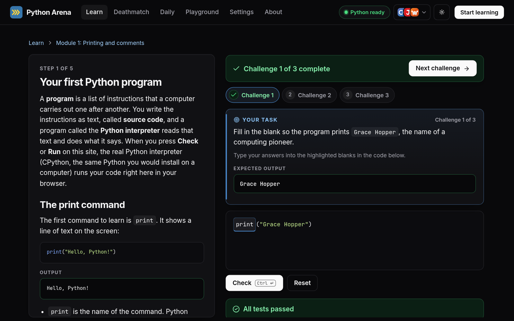
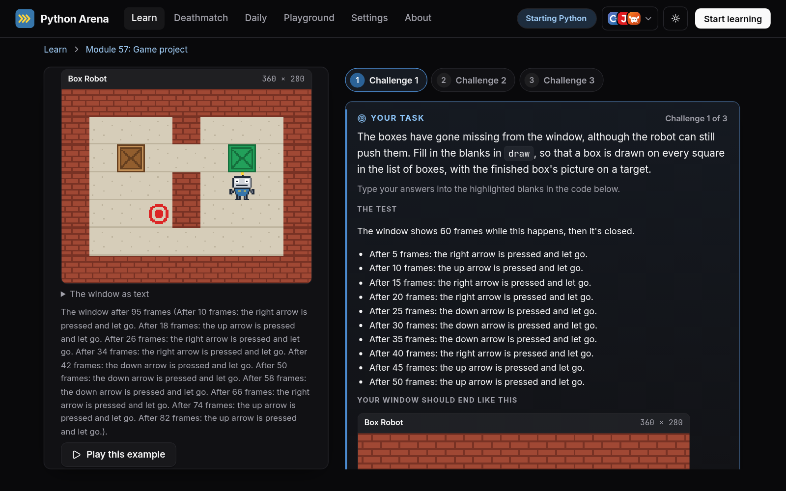
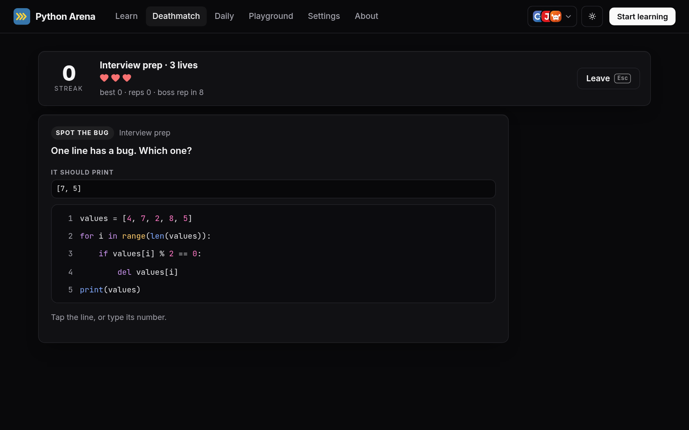
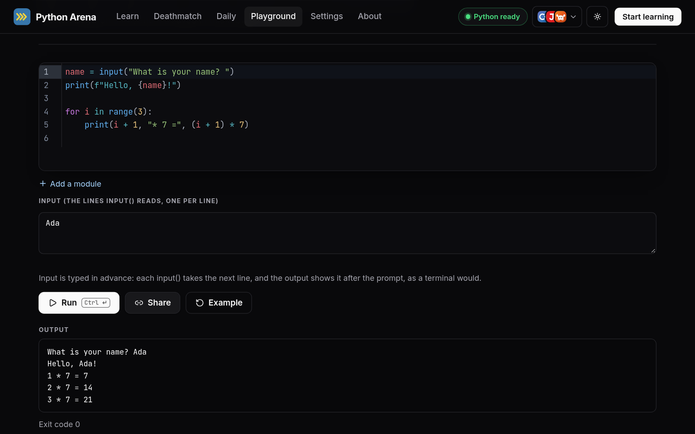
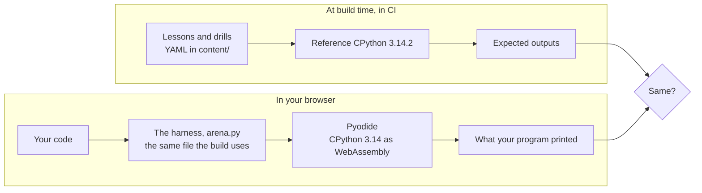

<div align="center">

<a href="https://pythonarena.org/"></a>

# Python Arena

**Learn Python by writing real Python, right in your browser.**

Free and non-commercial. No account, no ads, no tracking.

[](https://pythonarena.org/)
[](https://github.com/AntonyPerez0/pythonarena/actions/workflows/deploy.yml)
[](https://github.com/AntonyPerez0/pythonarena/stargazers)

[](https://www.python.org/)
[](https://pyodide.org/)
[](https://react.dev/)
[](LICENSE)
[](content/LICENSE)

[**Start learning**](https://pythonarena.org/learn/printing/) ·
[All modules](https://pythonarena.org/learn/) ·
[Deathmatch](https://pythonarena.org/deathmatch/) ·
[Playground](https://pythonarena.org/playground/) ·
[How it works](#how-it-works) ·
[Run it locally](#quick-start) ·
[Report a problem](https://github.com/AntonyPerez0/pythonarena/issues/new)

</div>

https://github.com/user-attachments/assets/741f3cc9-38af-4b16-a9a0-e6b7f0b9fc0e

<div align="center">

| 65 | 276 | 828 | 1,212 | 4 | 3 | 353 |
|:---:|:---:|:---:|:---:|:---:|:---:|:---:|
| modules | steps | challenges | Deathmatch drills | guided projects | Pro Track projects | reference topics |

</div>

## About

Python Arena is a site for learning Python in the browser, with **real Python running on your own device**: CPython 3.14, compiled to WebAssembly by [Pyodide](https://pyodide.org). It follows the order and topics of the University of Helsinki's [Python Programming MOOC 2026](https://programming-26.mooc.fi) (parts 1 to 14), with its own lessons and exercises.

<table>
  <tr>
    <td width="33%" valign="top">
      <h3>🐍 Real Python</h3>
      Every exercise runs on CPython 3.14 in your browser. Every example and model solution is checked on the reference CPython when the site is built, so the outputs you see are what Python really prints.
    </td>
    <td width="33%" valign="top">
      <h3>📚 The whole course</h3>
      65 modules: the MOOC's 58, from your first <code>print</code> to classes, recursion, regular expressions and games with pygame, plus 7 on data structures and algorithms.
    </td>
    <td width="33%" valign="top">
      <h3>💡 Errors in plain English</h3>
      Syntax errors and crashes come with a plain-English explanation and the line they happened on. Hints unlock one at a time, and a solution after all hints or three checks.
    </td>
  </tr>
  <tr>
    <td width="33%" valign="top">
      <h3>🎯 Deathmatch</h3>
      Endless quick drills: predict the output, fill the blank, spot the bug, will it run, pick one, and a boss rep every 8th rep. Your best streak sets your rank.
    </td>
    <td width="33%" valign="top">
      <h3>🛠️ Projects and Pro Track</h3>
      Four programs built over several milestones, then three projects for your own computer with Python 3.14 and pytest.
    </td>
    <td width="33%" valign="top">
      <h3>📴 Private and offline</h3>
      Progress stays in your browser. The site works offline once visited, can be installed as an app, and works on phones.
    </td>
  </tr>
</table>

> [!NOTE]
> Python Arena is not affiliated with or endorsed by the University of Helsinki, MOOC.fi or the Python Software Foundation. "Python" is a registered trademark of the Python Software Foundation.

## Contents

- [What's inside](#whats-inside)
- [Screenshots](#screenshots)
- [How it works](#how-it-works)
- [Curriculum](#curriculum)
- [Quick start](#quick-start)
- [Quality gates](#quality-gates)
- [Project layout](#project-layout)
- [Documentation](#documentation)
- [The Arena sites](#the-arena-sites)
- [License and credits](#license-and-credits)

## What's inside

| Feature | What you get |
|---|---|
| **Course** | 65 modules and 276 steps. Each step is a short lesson with three challenges: fill in the blanks, fix a program, write one, or predict what a program prints. Graded by input and output tests (some hidden), by tests that call your functions and methods, and by rules about the code. |
| **Deathmatch** | 1,212 quick drills that unlock as you finish lesson steps: predict the output, fill the blank, spot the bug, does it run, pick one, and a "boss rep" program to write every 8th rep. Four modes: one life, three lives, spaced review, and interview prep. |
| **Interview prep** | The data structures and algorithms modules, the interview drill sets, a table of which technique fits which kind of problem, what Python's operations cost, and a checklist for working through a problem out loud. |
| **Big tests** | Challenges sized so that a correct but slow way runs out of time, the way an interviewer asks "can you make it faster?" |
| **Daily challenge and placement quiz** | A drill a day, and a quiz that lets you skip the modules you already know. |
| **Projects** | Four larger programs built over several milestones: a calculator, the Game of Life, a text adventure and a library desk. Each milestone starts from your own code that passed the one before. |
| **Pro Track** | Three projects for your own computer with Python 3.14, a virtual environment and pytest: a word statistics tool, a book log stored in SQLite, and a memory game with pygame-ce. A GitHub Actions workflow runs the tests in your own repository. See [`pro-track/`](pro-track/README.md). |
| **Playground** | Write and run any program with your own input, in one file or several, and share it as a link. A pygame program runs in its window. |
| **pygame** | Windows, images, animation, events and two games. The page plays the frames your program draws, and pressing keys or clicking in the window runs it again with everything that happened so far. |
| **Topics A to Z** | 353 Python keywords, functions, methods, types, exceptions and ideas, each with a one-line description and links to the steps that teach it. |
| **Your progress** | Saved in the browser. Move it to another device with a link, a QR code or a file, and print a personal record of what you finished. |

Every feature is described in detail in [`docs/architecture.md`](docs/architecture.md).

## Screenshots

<table>
  <tr>
    <td width="50%" valign="top">
      <a href="docs/images/lesson.png"></a>
      <br><sub><b>Lessons.</b> A short lesson and three challenges per step, run by real Python on your device.</sub>
    </td>
    <td width="50%" valign="top">
      <a href="docs/images/pygame.png"></a>
      <br><sub><b>pygame.</b> The page shows the window your program draws, frame by frame.</sub>
    </td>
  </tr>
  <tr>
    <td width="50%" valign="top">
      <a href="docs/images/deathmatch.png"></a>
      <br><sub><b>Deathmatch.</b> Endless quick drills with lives, streaks and boss reps.</sub>
    </td>
    <td width="50%" valign="top">
      <a href="docs/images/playground.png"></a>
      <br><sub><b>Playground.</b> Run any program with your own input and share it as a link.</sub>
    </td>
  </tr>
</table>

## How it works



- **Python.** [Pyodide](https://pyodide.org) 314.0.7, which is CPython 3.14.2 compiled to WebAssembly. The pygame-ce wheel is downloaded only the first time a program imports pygame.
- **In the page.** One worker holds Python and runs a challenge's tests one after another. A test that runs past the time limit is stopped by replacing the worker, so an endless loop can't freeze the page. The engine downloads once and is kept in Cache Storage, so it also works offline. See [`src/engine/`](src/engine/).
- **The harness.** [`src/engine/arena.py`](src/engine/arena.py) runs a program in both the browser and the build, so what decides the output is the same file.
- **pygame without a screen.** Each frame a program shows becomes a picture and a text, "the window as text", and the clock is counted instead of waited for, so an animation runs the same every time.
- **Fidelity.** Expected outputs come from CPython 3.14.2 at build time, and CI replays every one of those programs in Pyodide and fails on any difference.

| Measure | Result |
|---|---|
| Engine download | about 6.4 MB, once, then cached |
| pygame-ce | 1.5 MB, the first time a program imports pygame |
| Time limit per test | 5 seconds, or 10 for a challenge with a big test |

<sub>[`docs/architecture.md`](docs/architecture.md#how-the-engine-works) has the full write-up.</sub>

## Curriculum

<details>
<summary><b>65 modules</b>: the 14 parts of the MOOC, then seven modules on data structures and algorithms</summary>

<br>

| Part | Modules | Topics |
|:---:|:---:|---|
| 1 | 1 to 5 | Printing and comments, information from the user, variables and f-strings, arithmetic, conditional statements |
| 2 | 6 to 9 | Programming terminology, more conditionals, combining conditions, simple loops |
| 3 | 10 to 13 | Loops with conditions, working with strings, more loops, defining functions |
| 4 | 14 to 18 | More functions, lists, definite iteration, print statement formatting, more strings and lists |
| 5 | 19 to 22 | More lists, references, dictionaries, tuples |
| 6 | 23 to 26 | Reading files, writing files, handling errors, local and global variables |
| 7 | 27 to 32 | Modules, randomness, times and dates, data processing, creating your own modules, more Python features |
| 8 | 33 to 36 | Objects and methods, defining classes, defining methods, more examples of classes |
| 9 | 37 to 40 | Objects and references, objects as attributes, encapsulation, class attributes |
| 10 | 41 to 44 | Class hierarchies, access modifiers, object-oriented programming techniques, developing a larger application |
| 11 | 45 to 48 | List comprehensions, more comprehensions, recursion, more recursion examples |
| 12 | 49 to 52 | Functions as arguments, generators, functional programming, regular expressions |
| 13 | 53 to 56 | pygame, animation, events, more pygame techniques |
| 14 | 57 to 58 | A game project, and your own game |
| Extra | 59 to 65 | Complexity and searching, sorting, hash tables, trees and heaps, graphs, recursion and backtracking, dynamic programming |

Parts 1 to 7 are the MOOC's Introduction to Programming and parts 8 to 14 its Advanced Course in Programming. The extra modules are Python Arena's own.

</details>

## Quick start

Needs Node 22.18 or newer and CPython 3.14.2, the version Pyodide runs. The content build looks for it as `$PYTHON`, then `python3.14` on the PATH, then `uv python find 3.14.2` (install it with `uv python install 3.14.2`).

```bash
git clone https://github.com/AntonyPerez0/pythonarena.git
cd pythonarena
npm install        # also copies Pyodide into public/engine
npm run dev        # checks the lessons, then serves http://localhost:5173/
```

| Script | What it does |
|---|---|
| `npm run dev` | Checks the lessons on the reference CPython, then starts the dev server |
| `npm run build` | Checks the lessons, type-checks and builds `dist/` (pre-rendered pages, service worker, sitemap) |
| `npm run test:unit` | Unit tests that need no browser |
| `npm run test:e2e` | Browser tests of the built site, including accessibility and phone widths |
| `npm run content:pyodide` | Replays every lesson program in Pyodide on Node and compares with CPython |
| `npm run pro-track-check` | Checks that each Pro Track starter fails its tests and each model solution passes |
| `npm run check-links` | Checks every internal and external link in the built site |

All scripts, what each CI job does and the domain setup are in [`docs/development.md`](docs/development.md).

## Quality gates

[`deploy.yml`](.github/workflows/deploy.yml) builds and tests every pull request, and publishes to GitHub Pages when one merges into `main`. The site is published only after the build and every check job pass:

- **Content build**: every example, model solution and drill runs on the reference CPython 3.14.2.
- **Pyodide replay**: every lesson program runs again in Pyodide and must match CPython.
- **Speed tests**: for each big test, the slow solution must run out of time and the model solution must keep well within it.
- **Browser tests**: lessons, the engine, endless loops, pygame windows, offline use, moving progress, projects and the Pro Track pages.
- **Phone pass**: every page type at phone widths in both themes, with axe (WCAG 2.2 AA).
- **Pro Track**: each starter fails its tests and each model solution passes them.
- **Link check**: every internal link resolves and every external link goes to an allowed host. Pull requests also get Lighthouse scores.

## Project layout

```
content/              Lessons, drills, projects and topics (YAML, CC BY-NC-SA 4.0)
engine-packages/      The pygame-ce wheel that Pyodide builds
engine-licenses/      License texts of the engine's parts
pro-track/            The Pro Track's starter projects (Python 3.14, pytest)
pro-track-solutions/  Their model solutions, used by CI
scripts/              Content build, pre-rendering, checks and tests
src/                  The site (React, TypeScript): pages, editor, grader, engine worker
docs/                 Architecture, development notes and the build history
```

## Documentation

| Document | What's in it |
|---|---|
| [Architecture](docs/architecture.md) | Every feature of the site and how the engine works, in detail |
| [Development](docs/development.md) | Running locally, every script, CI jobs, deploying your own copy and the domain setup |
| [Writing lessons](content/README.md) | The YAML format of modules, drills, projects and topics, and how they are checked |
| [The Pro Track](pro-track/README.md) | The projects for your own computer |
| [Build history](docs/history.md) | What was built, part by part |
| [Third-party notices](THIRD_PARTY_NOTICES.md) | Licenses of the engine's parts and the site's libraries |

## The Arena sites

Python Arena is one of four sites that teach a language the same way, free.

| Site | Teaches | Source |
|---|---|---|
| [C/C++ Arena](https://cpparena.com) | C and C++ | [cpp-arena](https://github.com/AntonyPerez0/cpp-arena) |
| [Java Arena](https://javaarena.com) | Java | [Java-Arena](https://github.com/AntonyPerez0/Java-Arena) |
| [RustArena](https://rustarena.app) | Rust | [RustArena](https://github.com/AntonyPerez0/RustArena) |
| **[Python Arena](https://pythonarena.org)** | Python | this repository |

## Feedback

Found a mistake in a lesson, or a program that behaves differently than on your own Python? Every challenge on the site has a "Report a problem" link that opens an issue with your code filled in, or you can [open an issue](https://github.com/AntonyPerez0/pythonarena/issues/new) here.

## License and credits

- **Site code**, and the Pro Track's projects in `pro-track/`: MIT. See [LICENSE](LICENSE) for what it covers.
- **Lesson content** in `content/`: [CC BY-NC-SA 4.0](content/LICENSE), as it follows the CC BY-NC-SA 4.0 licensed MOOC, by Erkki Kaila, Antti Laaksonen, Matti Luukkainen and others at the University of Helsinki.
- **Third-party components** keep their own licenses. See [THIRD_PARTY_NOTICES.md](THIRD_PARTY_NOTICES.md), with their texts in [`engine-licenses/`](engine-licenses/).

Python runs in the browser thanks to [Pyodide](https://pyodide.org), and the games run on [pygame-ce](https://pyga.me). The site's design is Java Arena's, in Python's blue and yellow.
